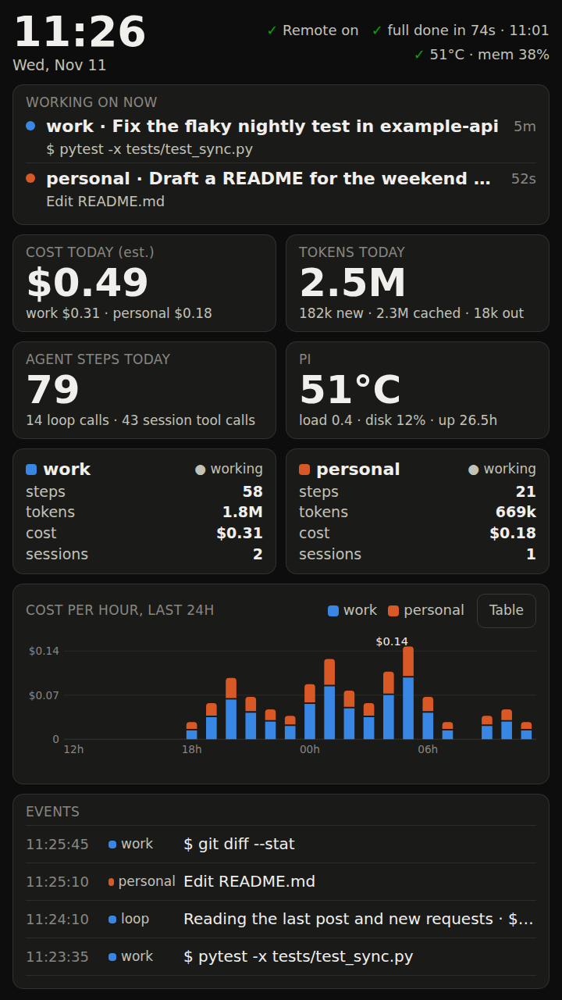

# pi-afterhours

Always-on Claude Code on a Raspberry Pi: a maintenance loop that watches your repos, a 7-inch touchscreen dashboard, and Remote Control from your phone and desktop. Unofficial.



## Why

My laptop shuts off. The work should not. This puts Claude Code on a small always-on box so it keeps checking pull requests, failing CI and data-platform health while I am away, tells me in Slack, and shows what it is doing on a screen on my desk. Everything runs on your own Claude subscriptions through the `claude` CLI, not on Anthropic's hosted cloud.

## What you get

- **Two Claude accounts side by side** (`cc work`, `cc personal`), each with its own login, settings and history, and a way to delegate a task from one to the other.
- **A maintenance loop** of small single-purpose agents (gate, post, spec, fix, review), each with a fixed model, a spending cap and a tool allowlist. It reads Slack for requests, sweeps repos hourly, and goes quiet when there is nothing new ("no further action").
- **Slack requests become short specs.** Ask for something in the channel and the loop replies with a brief spec. (Slack is optional.)
- **A touchscreen dashboard**: live runs, both profiles, tokens and cost per run, and a table of one-line events.
- **Remote Control** services so the personal account shows up in the phone app and the work account in Claude Desktop.
- **An installer, a doctor and a diagnostics collector** that redacts what it prints.

## Read this before you install

- **Not affiliated with Anthropic.** "Claude" and "Claude Code" are their products. This is a hobby project that drives the official CLI.
- **Tested on one Pi, the owner's.** Pi 5, Raspberry Pi OS (Debian 13), a 7-inch DSI touchscreen. The installer is untested from scratch: the unit tests run it against a fake root, and the author's Pi was built by hand before the installer existed. Expect to fix something. Run it with `--dry-run` first.
- **Published as is. No support is promised.** Issues may go unanswered. See [SECURITY.md](SECURITY.md) for reporting a security problem.
- **Real risk.** Agents run unattended with your credentials on the machine. The permission rules are a soft wall, not a sandbox: read [the security model](docs/07-security-model.md) before you go live.
- **Real cost.** Every run spends subscription or API budget. Figures in [costs and limits](docs/08-costs-and-limits.md) are an estimate from one setup.
- **Check your employer's policy** before pointing a work account at work repositories from a personal device.

## Ten-minute overview

```bash
git clone https://github.com/SybrandWildeboer/pi-afterhours.git
cd pi-afterhours
./install.sh --dry-run          # prints what it would do, changes nothing
./install.sh                    # then for real; it asks before each system change
scripts/doctor.sh               # OK / WARN / FAIL for every part
```

The installer never logs in for you and never creates `config.json`. After it runs:

1. Log in on the Pi (browser steps over SSH): [profiles and logins](docs/02-profiles-and-logins.md), [GitHub](docs/03-github.md).
2. Copy `~/maint/app/config.example.json` to `config.json` and list your repos.
3. The cron entries start in **dry-run**: they read and report but never post, merge, push or open PRs. Watch a few runs.
4. When you are happy: `./install.sh --go-live`.

## Guides

| | |
|---|---|
| [01 Hardware and OS](docs/01-hardware-and-os.md) | Pi 5, OS, screen, Wi-Fi, cable |
| [02 Profiles and logins](docs/02-profiles-and-logins.md) | `cc`, two accounts, trust pre-seeding |
| [03 GitHub](docs/03-github.md) | `gh` token in a file, deploy key, SSO |
| [04 Remote Control](docs/04-remote-control.md) | phone and desktop, delegation |
| [05 Maintenance loop](docs/05-maintenance-loop.md) | modes, schedule, dry-run, idle rule, agents |
| [06 Dashboard and screen](docs/06-dashboard-and-screen.md) | kiosk, touch mapping, lightdm |
| [07 Security model](docs/07-security-model.md) | threat model and known limits |
| [08 Costs and limits](docs/08-costs-and-limits.md) | estimates, subscription limits |
| [09 Troubleshooting](docs/09-troubleshooting.md) | lessons learned, laptop helpers |

## Development

```bash
scripts/run_tests.sh               # unit tests, no network, no Pi needed
python3 scripts/check_no_leaks.py  # refuses secrets, emails, IPs and your private terms
python3 scripts/check_docs.py      # docs: required files, links, caveats
python3 app/dash.py --demo         # dashboard with synthetic data on 127.0.0.1:8787
```

## Licence

MIT, see [LICENSE](LICENSE).
